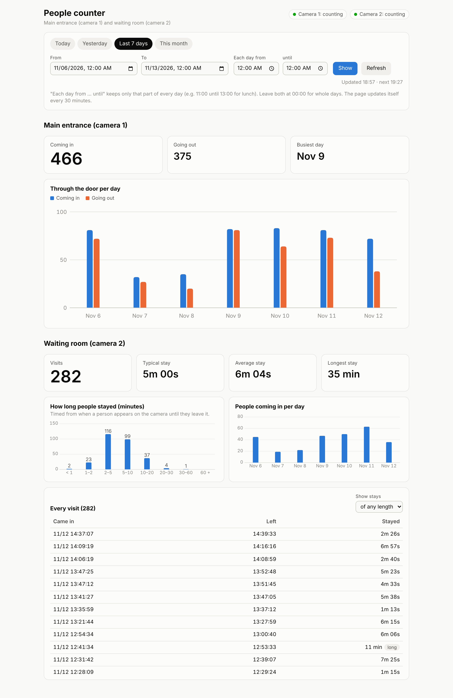

# DoorCounter

**Counts people through doors and measures how long they stay in a room, from ordinary security-camera streams, with no cloud service.**

DoorCounter pulls the RTSP streams of an existing NVR directly, so it doesn't depend on the vendor's software. It finds people with YOLO and follows them with ByteTrack. Then it does one of two jobs per camera:

- **doors**: counts IN and OUT crossings of a virtual line drawn across a doorway;
- **stay**: times each visit to a room, from when a person appears until they leave by any door.

Results go to CSV logs, a self-refreshing web dashboard on the local network, and a daily HTML report. It runs unattended on an ordinary office PC and has been running in production since 2026.



*The dashboard, filled with made-up data for this page.*

## Accuracy and performance (production install)

- **Exact on the validation clips**: 2 in / 2 out on one, 3 in / 3 out on the other, counted by hand. The first overnight run balanced at 64 in / 64 out.
- **About 19 fps on a 704×480 H.265 substream** with YOLO26n. That's the camera's full frame rate.
- **CPU went from 6–7 cores busy per counter to about 47% for the whole PC** after moving inference to the integrated Intel GPU with OpenVINO (`"device": "intel:gpu"`).

## The hard parts

Getting from "a detector draws boxes" to "the numbers are right" took most of the work:

- **Doorway jitter.** People who stop on the line made the count flip IN/OUT/IN. Two fixes handle it, both tunable: a dead zone on each side of the line (`line_margin`), and a person must stay on the new side for N frames and `settle_seconds` before a crossing counts.
- **Split tracks.** When legs vanish behind a cart and reappear, the tracker starts a new ID. `TrackStitcher` rejoins a track that reappears near where another vanished within `stitch_seconds`.
- **Duplicate boxes.** YOLO26 has no NMS and sometimes puts a second, partial box on one person; those are removed before tracking.
- **Visits in the stay mode.** A person can be hidden behind something or bend out of view. A visit only ends after `rejoin_seconds` without them, and a new track appearing near the spot continues the same visit.
- **RTSP reality.** Streams are pulled over TCP, because UDP smeared frames. FFmpeg is kept quiet and every log line masks RTSP credentials. The connection check stops after one failed login, because the NVR locks its account after about five.
- **Running unattended on Windows.** A supervisor (`run_all.py`) starts one counter per camera plus the dashboard and restarts anything that dies, backing off from 10 s to 5 min. It allows a single instance through a port lock and puts everything in a kill-on-close Windows job object, so stopping the task stops every child process. It opts the counters out of Windows power throttling and writes yesterday's report just after midnight.

## Privacy

DoorCounter **counts and times**. It doesn't recognize faces, identify anyone or keep video. Its logs hold timestamps, directions and durations only.

## Tools

| Script | What it does |
|---|---|
| `rtsp_check.py` | Tests the NVR login and saves a snapshot of every channel |
| `set_doors.py --channel N` | Draws the door lines on a snapshot: click both ends, then the inside |
| `record_clip.py --channel N` | Records a test clip live, or from the NVR's recordings |
| `door_counter.py --channel N` | Runs the live counter (`--source clip.mp4` to test on a recording, `--show` for a preview window) |
| `daily_report.py` | Writes a one-page HTML report per day |
| `dashboard.py` + `dashboard.html` | Serves the network dashboard: date ranges, "each day from … until" window, stay filter, status light per camera |
| `run_all.py` | Runs everything unattended (Windows scheduled task at logon) |

Every camera is configured in `settings.json`: shared detection settings, plus a `cameras` list where each entry can override any of them.

## Setup

```bash
python -m venv .venv
.venv/bin/pip install -r requirements.txt      # Windows: .venv\Scripts\pip
cp lorex.env.example lorex.env                  # then fill in the NVR address and login
python rtsp_check.py
python set_doors.py --channel 1
python door_counter.py --channel 1 --show
python dashboard.py                             # http://<this PC>:8790
```

It was built for a Lorex NVR, which is Dahua inside. Any NVR or camera using Dahua-style RTSP paths works as is; for others, change `live_path` and `playback_path` in `common.py`.

## Built with

Python · Ultralytics YOLO26 · ByteTrack (`trackers`) · Supervision · OpenCV · OpenVINO · PyTorch · vanilla JavaScript (dashboard charts drawn as SVG, no chart library).
